<div align="center">
  <h1 align="center"> unitree_sim_isaaclab </h1>
  <h3 align="center"> Unitree Robotics </h3>
  <p align="center">
    <a> English </a> | <a href="README_zh-CN.md">中文</a>
  </p>
  <a href="https://discord.gg/ZwcVwxv5rq" target="_blank"></a>
</div>

## Important Notes First
- Isaac Sim 4.5 / 5.0 / 5.1: Please switch to the IsaacSim5.1.0 branch.
- Requirements: For the minimum installation requirements of Isaac Sim, please refer to the [official documentation](https://isaac-sim.github.io/IsaacLab/main/source/setup/installation/index.html) .
- The first startup takes a while: Isaac Sim loads and caches its extensions and shaders, and robots given as URDF are converted to USD (cached afterwards).
- The simulator sends and receives the same DDS topics as the real robot (DDS domain 1). If a real robot is running on the same network, make sure you can tell them apart. For DDS usage see [G1 control](https://github.com/unitreerobotics/unitree_sdk2_python/tree/master/example/g1) and [Dex3 control](https://github.com/unitreerobotics/unitree_sdk2/blob/main/example/g1/dex3/g1_dex3_example.cpp).
- The weight files provided in this project are only for testing in simulation.

## 1、 📖 Introduction

This project is built on **Isaac Lab** to provide a multi-task simulation platform for **Unitree robots**, supporting data collection, replay, generation, and model validation. It can be integrated with [xr_teleoperate](https://github.com/unitreerobotics/xr_teleoperate) for teleoperation-based data collection. The project adopts the same **DDS communication mechanism** as real robots to improve code reusability and ease of use, while providing simulation environments, data interfaces, and experimental validation capabilities for intelligent systems such as **Agent, and RSI (Recursive Self-Improvement)**.

Supported robots:

| Robot | `--robot_type` | End effectors | Notes |
|---|---|---|---|
| G1 29-DoF | `g129` | Dex1 gripper / Dex3 / Inspire | fixed base; `Wholebody` tasks can walk |
| H1-2 27-DoF | `h1_2` | Inspire | fixed base |
| G1-D | `g1d` | Dex1 gripper | wheeled base, lift column, waist |
| R1-D | `r1d` | Dex1 gripper | wheeled base, two-stage lift, waist, head |

Task scenes (columns: tasks, rows: robots; — = not available). Tasks with `Wholebody` in their name support mobile manipulation (the G1 walks).

<table>
  <tr>
    <th>Robot</th>
    <th align="center">Pick & place<br/>cylinder</th>
    <th align="center">Pick & place<br/>red block</th>
    <th align="center">Stack<br/>RGY blocks</th>
    <th align="center">Red block<br/>into drawer</th>
    <th align="center">Move cylinder<br/>(walking)</th>
  </tr>
  <tr>
    <th align="left">G1<br/>Dex1</th>
    <td align="center" width="128">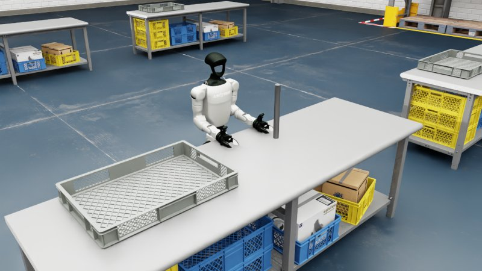</td>
    <td align="center" width="128"></td>
    <td align="center" width="128">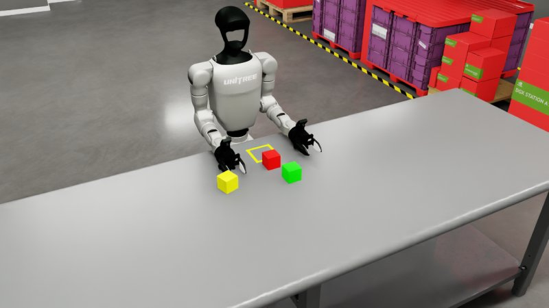</td>
    <td align="center" width="128">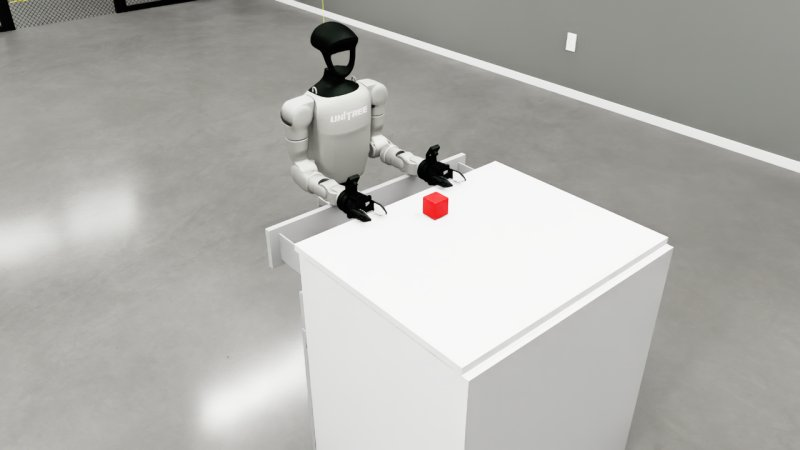</td>
    <td align="center" width="128">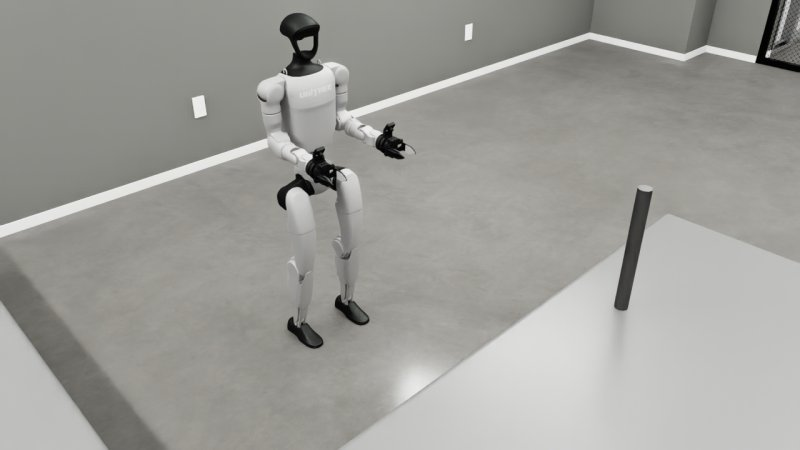</td>
  </tr>
  <tr>
    <th align="left">G1<br/>Dex3</th>
    <td align="center" width="128">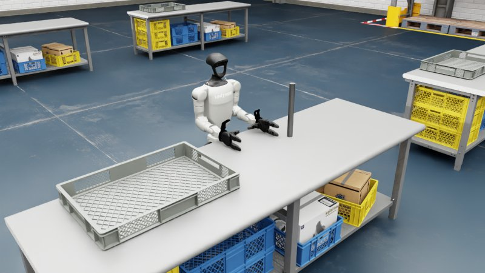</td>
    <td align="center" width="128">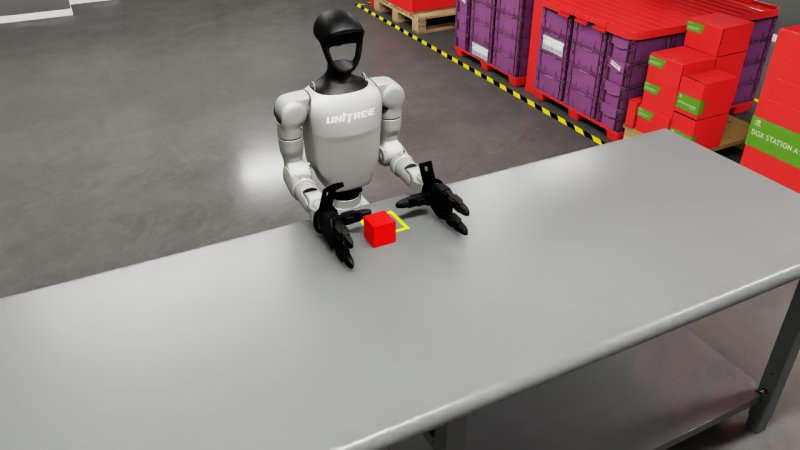</td>
    <td align="center" width="128"></td>
    <td align="center" width="128">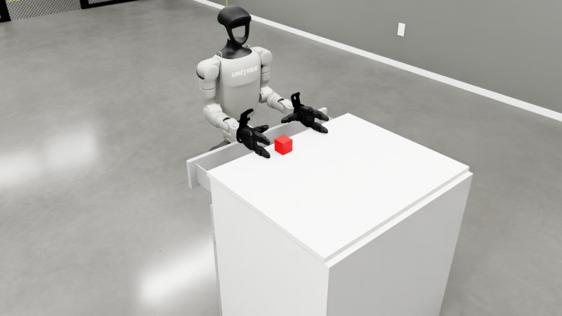</td>
    <td align="center" width="128">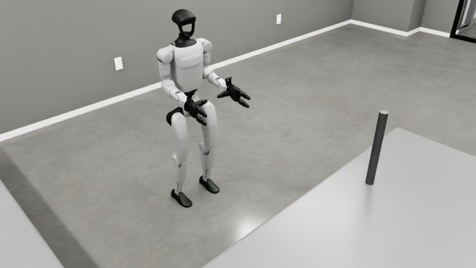</td>
  </tr>
  <tr>
    <th align="left">G1<br/>Inspire</th>
    <td align="center" width="128">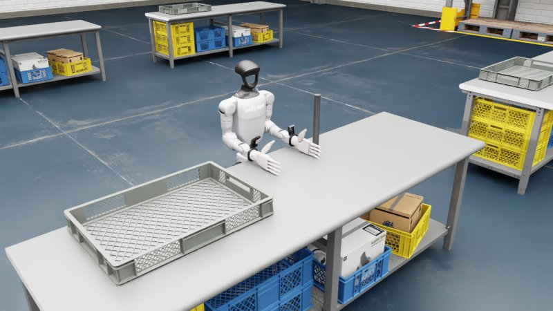</td>
    <td align="center" width="128">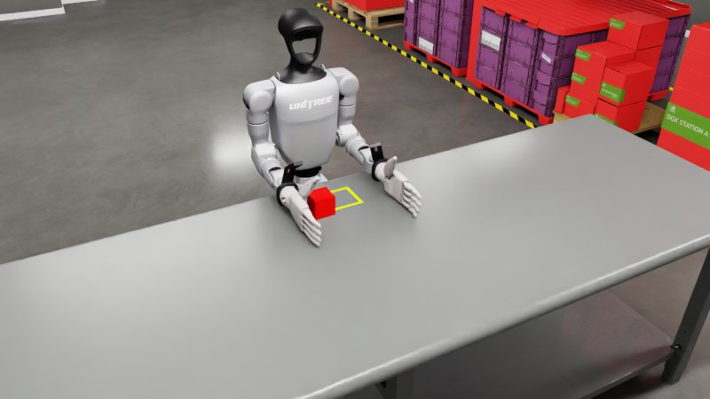</td>
    <td align="center" width="128">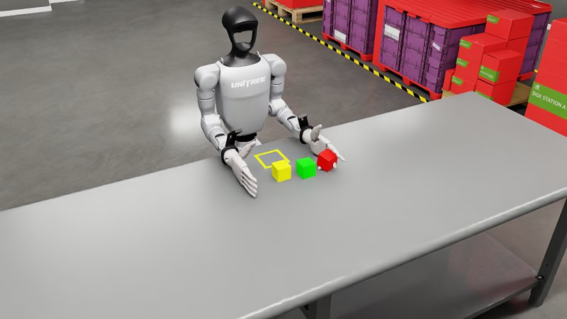</td>
    <td align="center">—</td>
    <td align="center" width="128">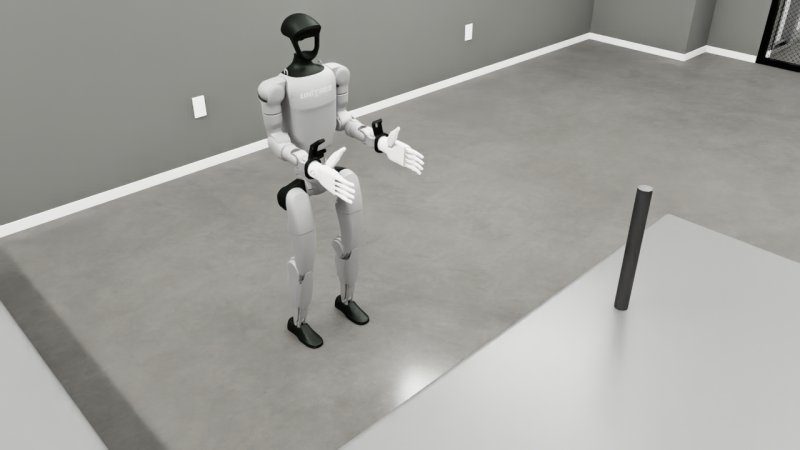</td>
  </tr>
  <tr>
    <th align="left">H1-2<br/>Inspire</th>
    <td align="center" width="128">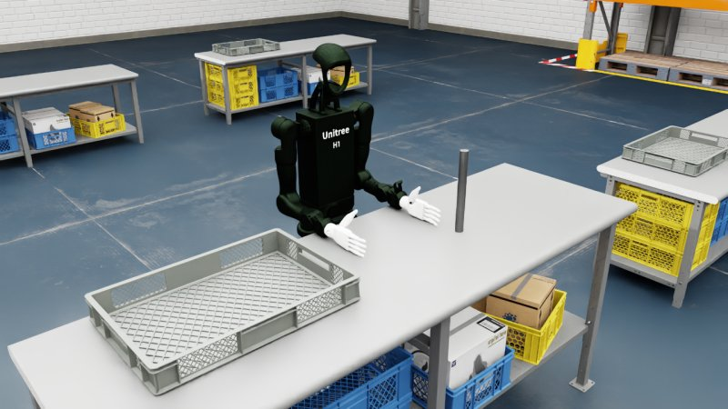</td>
    <td align="center" width="128">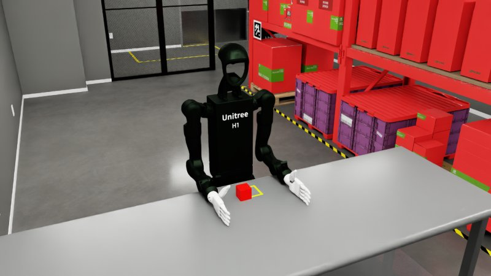</td>
    <td align="center" width="128">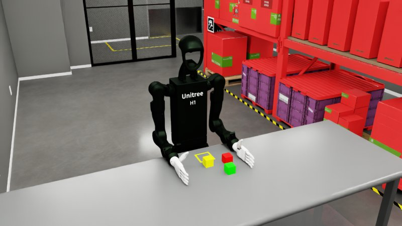</td>
    <td align="center">—</td>
    <td align="center">—</td>
  </tr>
  <tr>
    <th align="left">G1-D<br/>Dex1</th>
    <td align="center" width="128">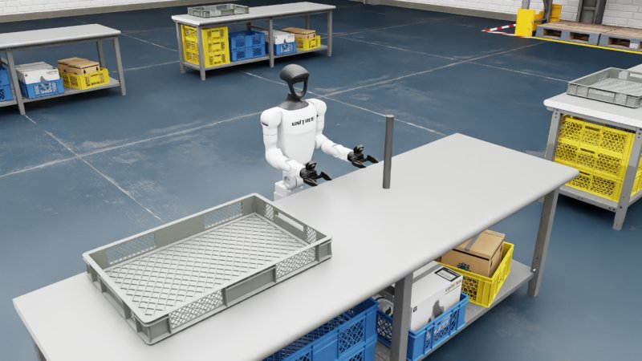</td>
    <td align="center">—</td>
    <td align="center">—</td>
    <td align="center">—</td>
    <td align="center">—</td>
  </tr>
  <tr>
    <th align="left">R1-D<br/>Dex1</th>
    <td align="center" width="128">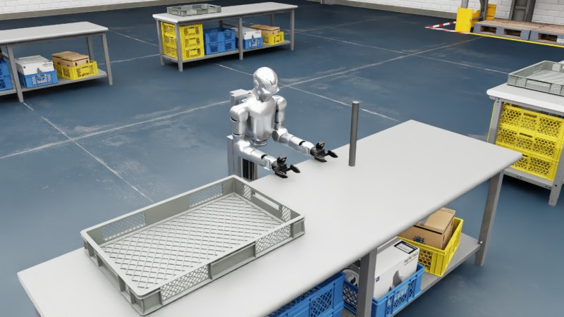</td>
    <td align="center">—</td>
    <td align="center">—</td>
    <td align="center">—</td>
    <td align="center">—</td>
  </tr>
</table>

Task names (`--task`) and the matching arguments:

| Task | Robot | `--robot_type` | Hand DDS |
|---|---|---|---|
| `Isaac-PickPlace-Cylinder-G129-Dex1-Joint` | G1 29-DoF · Dex1 | `g129` | `--enable_dex1_dds` |
| `Isaac-PickPlace-RedBlock-G129-Dex1-Joint` | G1 29-DoF · Dex1 | `g129` | `--enable_dex1_dds` |
| `Isaac-Stack-RgyBlock-G129-Dex1-Joint` | G1 29-DoF · Dex1 | `g129` | `--enable_dex1_dds` |
| `Isaac-Pick-Redblock-Into-Drawer-G129-Dex1-Joint` | G1 29-DoF · Dex1 | `g129` | `--enable_dex1_dds` |
| `Isaac-Move-Cylinder-G129-Dex1-Wholebody` | G1 29-DoF · Dex1 | `g129` | `--enable_dex1_dds` |
| `Isaac-PickPlace-Cylinder-G129-Dex3-Joint` | G1 29-DoF · Dex3 | `g129` | `--enable_dex3_dds` |
| `Isaac-PickPlace-RedBlock-G129-Dex3-Joint` | G1 29-DoF · Dex3 | `g129` | `--enable_dex3_dds` |
| `Isaac-Stack-RgyBlock-G129-Dex3-Joint` | G1 29-DoF · Dex3 | `g129` | `--enable_dex3_dds` |
| `Isaac-Pick-Redblock-Into-Drawer-G129-Dex3-Joint` | G1 29-DoF · Dex3 | `g129` | `--enable_dex3_dds` |
| `Isaac-Move-Cylinder-G129-Dex3-Wholebody` | G1 29-DoF · Dex3 | `g129` | `--enable_dex3_dds` |
| `Isaac-PickPlace-Cylinder-G129-Inspire-Joint` | G1 29-DoF · Inspire | `g129` | `--enable_inspire_dds` |
| `Isaac-PickPlace-RedBlock-G129-Inspire-Joint` | G1 29-DoF · Inspire | `g129` | `--enable_inspire_dds` |
| `Isaac-Stack-RgyBlock-G129-Inspire-Joint` | G1 29-DoF · Inspire | `g129` | `--enable_inspire_dds` |
| `Isaac-Move-Cylinder-G129-Inspire-Wholebody` | G1 29-DoF · Inspire | `g129` | `--enable_inspire_dds` |
| `Isaac-PickPlace-Cylinder-H12-27dof-Inspire-Joint` | H1-2 27-DoF · Inspire | `h1_2` | `--enable_inspire_dds` |
| `Isaac-PickPlace-RedBlock-H12-27dof-Inspire-Joint` | H1-2 27-DoF · Inspire | `h1_2` | `--enable_inspire_dds` |
| `Isaac-Stack-RgyBlock-H12-27dof-Inspire-Joint` | H1-2 27-DoF · Inspire | `h1_2` | `--enable_inspire_dds` |
| `Isaac-PickPlace-Cylinder-G1D-Dex1-Joint` | G1-D · Dex1 | `g1d` | `--enable_dex1_dds` |
| `Isaac-PickPlace-Cylinder-R1D-Dex1-Joint` | R1-D · Dex1 | `r1d` | `--enable_dex1_dds` |

## 2、⚙️ Environment Setup and Running

| Component | Version |
|---|---|
| Isaac Sim | 6.2.0 (`isaacsim[all,extscache]==6.2.0.0`) |
| Isaac Lab | 3.0.0 (tag `v3.0.0`) |
| Python | 3.12 |
| PyTorch | 2.11.0 / torchvision 0.26.0 (CUDA 13.0, `cu130`) |
| CycloneDDS | `releases/0.10.x` |
| teleimager (image server) | git submodule `teleimager/`, branch `sim` |

### 2.0 Get the code

The image server [teleimager](https://github.com/unitreerobotics/teleimager) is a git submodule, so clone with `--recurse-submodules`:

```bash
git clone --recurse-submodules https://github.com/unitreerobotics/unitree_sim_isaaclab.git
# already cloned without it:
cd unitree_sim_isaaclab && git submodule update --init --recursive
```

After pulling a newer version of this repository, also update the submodule (and reinstall it if its dependencies changed):

```bash
git pull
git submodule update --init --recursive
pip install -e "./teleimager[server]"
```

To follow the latest commit of teleimager's `sim` branch instead of the pinned one: `git submodule update --remote teleimager`.

### 2.1 Automatic installation (recommended)

```bash
cd unitree_sim_isaaclab
bash auto_setup_env.sh unitree_sim_env          # optional 2nd argument: PyTorch CUDA tag, default cu130
conda activate unitree_sim_env
```

The script initializes the `teleimager` submodule, clones `IsaacLab` (v3.0.0), `cyclonedds` and `unitree_sdk2_python` next to this repository, creates the conda environment, installs everything listed below (including `teleimager[server]`), generates the image server certificates and downloads the assets.

### 2.2 Manual installation

See <a href="doc/isaacsim6.2_install.md">Isaac Sim 6.2.0 / Isaac Lab 3.0.0 installation steps</a>.

### 2.3 Docker

```bash
cd unitree_sim_isaaclab
git submodule update --init --recursive                # the image is built from this checkout, incl. teleimager
bash fetch_assets.sh                                   # assets are mounted, not built into the image
sudo docker build -t unitree-sim:latest -f Dockerfile .
# behind a proxy: --build-arg http_proxy=http://127.0.0.1:7890 --build-arg https_proxy=http://127.0.0.1:7890
```

The image (base `nvidia/cuda:13.0.0-runtime-ubuntu22.04`) contains Isaac Sim 6.2.0, Isaac Lab 3.0.0, CycloneDDS, unitree_sdk2_python and the source of this repository. The host needs an NVIDIA driver ≥ 580.65.06 and the NVIDIA Container Toolkit.

```bash
xhost +local:docker
sudo docker run --gpus all -it --rm --network host \
  -e NVIDIA_VISIBLE_DEVICES=all -e NVIDIA_DRIVER_CAPABILITIES=all \
  -e DISPLAY=$DISPLAY -v /tmp/.X11-unix:/tmp/.X11-unix:rw \
  -v /etc/vulkan/icd.d:/etc/vulkan/icd.d:ro -v /usr/share/vulkan/icd.d:/usr/share/vulkan/icd.d:ro \
  -v $(pwd)/assets:/home/code/unitree_sim_isaaclab/assets \
  unitree-sim:latest
# inside the container (add --no_render on a headless server):
python sim_main.py --device cpu --task Isaac-PickPlace-Cylinder-G129-Dex1-Joint --enable_dex1_dds --robot_type g129
```

`--network host` lets the DDS topics and the image server ports reach the host network.

### 2.4 Assets

Assets are downloaded file by file from the `assets/` folder of the HuggingFace dataset [unitreerobotics/unitree_sim_isaaclab_usds](https://huggingface.co/datasets/unitreerobotics/unitree_sim_isaaclab_usds) into `./assets` (also done by `auto_setup_env.sh`; scenes, G1 / H1-2 USDs and the G1-D / R1-D URDFs):

```bash
bash fetch_assets.sh                                   # all assets
bash fetch_assets.sh robots/g1-29dof-dex1-base-fix-usd urdf   # only these folders (paths below assets/)
```

Re-running only fetches missing or updated files; local files that are not in the dataset (e.g. `assets/robots/.urdf_cache`, your own scenes) are kept. Use `HF_ENDPOINT=https://hf-mirror.com` for a mirror.

Upload (token with write access to the `unitreerobotics` organization; only new / modified files are sent, local caches are skipped): `HF_TOKEN=hf_xxx bash upload_assets.sh [scenes/kitchen ...]`.

Robots may be given either as USD or as URDF (`robots/robot_assets.py`): a URDF is converted to USD on first use and cached in `assets/robots/.urdf_cache/`. G1-D and R1-D are loaded from
`assets/urdf/g1_d_description/g1_d_with_dex1_1.urdf` and `assets/urdf/r1_d_description/r1_d_with_dex1_1.urdf`.

### 2.5 Teleoperation

```bash
# G1 29-DoF + Dex1 gripper
python sim_main.py --device cpu --task Isaac-PickPlace-Cylinder-G129-Dex1-Joint --enable_dex1_dds --robot_type g129
# G1 29-DoF + Dex3
python sim_main.py --device cpu --task Isaac-PickPlace-Cylinder-G129-Dex3-Joint --enable_dex3_dds --robot_type g129
# H1-2 + Inspire
python sim_main.py --device cpu --task Isaac-PickPlace-Cylinder-H12-27dof-Inspire-Joint --enable_inspire_dds --robot_type h1_2
# G1 Wholebody (walking)
python sim_main.py --device cpu --task Isaac-Move-Cylinder-G129-Dex1-Wholebody --enable_dex1_dds --robot_type g129
# G1-D
python sim_main.py --device cpu --task Isaac-PickPlace-Cylinder-G1D-Dex1-Joint --enable_dex1_dds --robot_type g1d
# R1-D
python sim_main.py --device cpu --task Isaac-PickPlace-Cylinder-R1D-Dex1-Joint --enable_dex1_dds --robot_type r1d
```

Main arguments:
- `--task`: task name (see the table above).
- `--robot_type`: `g129` | `h1_2` | `g1d` | `r1d`. Selects the body DDS and the action mapping; it must match the robot of the task.
- `--enable_dex1_dds` / `--enable_dex3_dds` / `--enable_inspire_dds`: enable DDS for the Dex1 gripper / Dex3 hand / Inspire hand (only one at a time).
- `--enable_wholebody_dds`: enable the locomotion commands (switched on automatically for `Wholebody` tasks).
- `--camera_calib <file>`: camera calibration file (see 2.6). Default: `$UNITREE_CAMERA_CALIB` or `robots/uniclib_calibration.json`.
- `--camera_include` / `--camera_exclude`: comma-separated camera names to enable / disable (default: head stereo pair + both wrist cameras).
- `--no_render`: run without the Sim window and enable the WebRTC livestream (use this inside Docker / on a headless server); view it with the [Isaac Sim WebRTC Streaming Client](https://docs.isaacsim.omniverse.nvidia.com/latest/installation/manual_livestream_clients.html).
- `--device cpu`: run physics on the CPU (recommended for the teleoperation tasks).
- `--render_fps` (default 30): rendering rate of the cameras and the viewport, in simulation time; the control loop keeps running at `--step_hz`. Higher = smoother images, slower simulation.
- `--render_sync`: wait for the GPU at every render (exactly synchronous images, slower). By default an image may be one render old.
- `--image_server_in_process`: run the image server in the simulator process (old behaviour; by default it runs in its own process).
- `--view_camera` (`auto` | `world` | `follow` | `none`): viewport camera at start-up. `world` = fixed overview camera `/World/PerspectiveCamera`, `follow` = chase camera behind the robot `/World/FollowCamera` (follows position and heading), `auto` = `follow` for mobile robots (G1-D, R1-D, `Wholebody` tasks), else `world`. Both can be selected any time in the viewport camera menu; they are plain USD cameras and cost nothing while not viewed.

DDS topics per robot (domain 1):

| Robot | Body | End effector | Base / lift |
|---|---|---|---|
| G1 / H1-2 | `rt/lowcmd`, `rt/lowstate` (unitree_hg) | `rt/dex1/{left,right}/*`, `rt/dex3/{left,right}/*`, `rt/inspire/*` | `Wholebody`: `rt/run_command/cmd` (see `send_commands_keyboard.py`, `send_commands_8bit.py`) |
| G1-D | `rt/lowcmd`, `rt/lowstate` (waist yaw 12, arms 15–28; waist pitch: `rt/waistpitchcmd` → `rt/waistpitchstate`, also lowstate 13/14, lowcmd 13 when enabled) | lowcmd/lowstate 31 (left) / 33 (right), or `rt/dex1/{left,right}/*` | `rt/cmd_vel_no_limit`, `rt/cmd_hispeed` → `rt/hispeed_state`, `rt/slamware_ros_sdk_server_node/odom` |
| R1-D | `rt/lowcmd`, `rt/lowstate` (column 12, waist 13, arms 15–28, head 29/30) | lowcmd/lowstate 31 (left) / 33 (right), or `rt/dex1/{left,right}/*` | `rt/cmd_vel` (normalized) → `rt/state_vel`, `rt/height_state`, `rt/height_alarm` |

G1-D / R1-D follow the real robots' unirobot layout: the Dex1 grippers are lowcmd motors 31 / 33 ("internal" wiring, motor q 0 closed … 5.4 open, used when the slot has mode 1 and kp > 0; they then take precedence over `rt/dex1/*`), and the G1-D waist pitch is commanded on `rt/waistpitchcmd` (unitree_hg `MotorCmd_`). Until `rt/waistpitchcmd` is received, lowcmd motor 13 drives the waist pitch only if its mode is 1. The lowstate lists both gripper motors and the waist pitch on 13 and 14.

The R1-D speed gear can be set with the environment variable `UNITREE_R1D_GEAR=low|mid|high` (default `low`).

### 2.6 Cameras and image server

The simulator publishes its camera images through the image server [teleimager](https://github.com/unitreerobotics/teleimager) (git submodule `teleimager/`, branch `sim`; simulator config `teleimager_server_isaacsim.yaml` bundled in the package, override with `$TELEIMAGER_CONFIG`), the same interface as the real robot's image server, so [xr_teleoperate](https://github.com/unitreerobotics/xr_teleoperate) can connect directly (set the image server IP in xr_teleoperate to the machine running the simulation).

| Camera | ZMQ | WebRTC (https) |
|---|---|---|
| head (stereo, 1280×480 side by side) | 55555 | 60001 |
| left wrist | 55556 | 60002 |
| right wrist | 55557 | 60003 |

- The head is a stereo camera. Intrinsics, distortion, stereo extrinsics and the wrist hand-eye poses are read from the calibration file (`--camera_calib`, format of `robots/uniclib_calibration.json`). Values that are missing or don't belong to the simulated robot fall back to the camera mounts of the robot's URDF / USD.
- The image server stops at startup with an error if one of its ports is already in use. Ports in the ephemeral range can be taken by other programs; reserve them with
  `sudo sysctl -w net.ipv4.ip_local_reserved_ports=55555-55557,60001-60003` (add it to `/etc/sysctl.conf` to keep it).
- The WebRTC pages use the self-signed certificate in `~/.config/teleimager/` (created by `auto_setup_env.sh`; if missing, the one in `~/.config/xr_teleoperate/` is used); accept it in the browser the first time.

### 2.7 Keyboard test scripts

To try a robot without an XR device, start the simulation (2.5) and then run in another terminal of the same environment:

```bash
python tools/g1_keyboard_teleop.py --hand dex1     # G1: arms + hands (dex1 / dex3 / inspire)
python tools/g1d_keyboard_teleop.py                # G1-D: base, lift, waist, arms, grippers
python tools/r1d_keyboard_teleop.py                # R1-D: base, lift, waist, head, arms, grippers
```

They publish the same DDS topics as xr_teleoperate. The hands are moved in Cartesian space (inverse kinematics in `tools/arm_ik.py`):

| Keys | Action |
|---|---|
| I / K, J / L, U / O | hand forward / back, left / right, up / down |
| [ / ], ; / ', , / . | roll, pitch, yaw |
| TAB | switch hand: left / right / both (mirrored) |
| P | back to the start pose |
| Z / X, C / V | left / right gripper close / open |
| W / S, A / D | base forward / back, turn (G1-D, R1-D) |
| R / F, SPACE | lift up / down, stop base and lift (G1-D, R1-D) |
| T / G, Y / H | G1-D: waist pitch / yaw; R1-D: head pitch / yaw |
| Q / E | R1-D: waist yaw |
| ESC | quit |

### 2.8 Data replay

```bash
python sim_main.py --device cpu --task Isaac-Stack-RgyBlock-G129-Dex1-Joint --enable_dex1_dds --robot_type g129 \
    --replay_data --file_path "/path/to/xr_teleoperate/teleop/utils/data"
```
- `--replay_data`: replay a recorded dataset.
- `--file_path`: dataset directory (format recorded by [xr_teleoperate](https://github.com/unitreerobotics/xr_teleoperate)).

Task-discrete rewards can be read with `get_step_reward_value`.

### 2.9 Data generation

During replay, lighting and camera parameters can be changed and images re-captured, to generate more diverse visual data for augmentation.

```bash
python sim_main.py --device cpu --task Isaac-Stack-RgyBlock-G129-Dex1-Joint --enable_dex1_dds --robot_type g129 \
    --replay_data --file_path "/path/to/xr_teleoperate/teleop/utils/data" --generate_data --generate_data_dir "./data2"
```
- `--generate_data`: generate new data; `--generate_data_dir`: output directory.
- `--rerun_log`: log with rerun during generation.
- `--modify_light` / `--modify_camera`: modify the lighting / camera parameters (adjust `update_light` / `batch_augment_cameras_by_name` in `sim_main.py`).

Tune and test these parameters carefully before generating data at scale.

## 3、Task Scene Construction

### 3.1 Code structure

```
unitree_sim_isaaclab/
├── action_provider          [action sources: DDS (G1/H1-2, Wholebody, G1-D, R1-D), file replay, policy]
├── dds                      [DDS communication: robot body, Dex1 / Dex3 / Inspire, G1-D / R1-D base & lift, rewards, reset]
├── layeredcontrol           [low-level control: applies actions to the environment]
├── robots
│   ├── robot_assets.py      [load robots from USD or URDF (URDF -> USD conversion, link colors, link prim paths)]
│   ├── unitree.py           [G1 / H1-2 configurations]
│   ├── unitree_g1d.py       [G1-D configuration]
│   ├── unitree_r1d.py       [R1-D configuration]
│   └── uniclib_calibration.json  [default camera calibration]
├── tasks
│   ├── common_config        [robot / camera presets, camera calibration loading, environment base config]
│   ├── common_event         [event management]
│   ├── common_observations  [robot / hand / gripper / camera state -> DDS & shared memory]
│   ├── common_rewards
│   ├── common_scene         [shared scenes (everything except the robot)]
│   ├── common_termination   [object out of range / reset conditions]
│   ├── g1_tasks             [G1 tasks]
│   ├── h1-2_tasks           [H1-2 tasks]
│   ├── g1d_tasks            [G1-D tasks]
│   ├── r1d_tasks            [R1-D tasks]
│   └── utils
├── teleimager               [image server (ZMQ + WebRTC), git submodule, branch sim]
├── tools                    [keyboard test scripts, arm IK, data conversion, USD tools]
├── auto_setup_env.sh        [environment setup]
├── fetch_assets.sh          [asset download]
└── sim_main.py              [entry point]
```

### 3.2 Steps to build a new task

To build a new task with an existing robot configuration:

#### 3.2.1 Common scene
Add the scene (everything except the robot) in `tasks/common_scene`, following the existing files.

#### 3.2.2 Termination / reset conditions
Add the conditions in `tasks/common_termination`.

#### 3.2.3 Add and register the task
Create a task directory below `tasks/<robot>_tasks/`, following an existing task, e.g. `pick_place_cylinder_g1_29dof_dex1`:

- `mdp/observations.py`: import the observation functions you need

```python
from tasks.common_observations.g1_29dof_state import get_robot_boy_joint_states
from tasks.common_observations.gripper_state import get_robot_gipper_joint_states
from tasks.common_observations.camera_state import get_camera_image

__all__ = ["get_robot_boy_joint_states", "get_robot_gipper_joint_states", "get_camera_image"]
```

- `mdp/terminations.py`: import the conditions from `common_termination`

```python
from tasks.common_termination.base_termination_pick_place_cylinder import reset_object_estimate

__all__ = ["reset_object_estimate"]
```

- `__init__.py`: register the task name

```python
import gymnasium as gym

from . import pickplace_cylinder_g1_29dof_dex1_joint_env_cfg

gym.register(
    id="Isaac-PickPlace-Cylinder-G129-Dex1-Joint",
    entry_point="isaaclab.envs:ManagerBasedRLEnv",
    kwargs={"env_cfg_entry_point": pickplace_cylinder_g1_29dof_dex1_joint_env_cfg.PickPlaceG129DEX1BaseFixEnvCfg},
    disable_env_checker=True,
)
```

- The environment configuration (e.g. `pickplace_cylinder_g1_29dof_dex1_joint_env_cfg.py`): import the common scene, set the robot pose and add the cameras. Derive it from `tasks.common_config.env_configs.UnitreeManagerBasedRLEnvCfg`. With Isaac Lab 3.0, quaternions are written in **(x, y, z, w)** order.
- Import the new task module in `tasks/<robot>_tasks/__init__.py`.

### 3.3 Create tasks from your own USD scene

Any USD scene (a room, a kitchen, ...) can be combined with the robots in one step:

```bash
python tools/create_usd_task.py --usd /path/to/scene.usda --name Kitchen --robot-pose 1.0,-2.0,0 --check
python sim_main.py --device cpu --task Isaac-Kitchen-R1D-Dex1-Joint --enable_dex1_dds --robot_type r1d
```

- The USD and every file it references are copied to `assets/scenes/<name>/`; the scene is simulated as it is (its own rigid bodies, doors, lights). Units / up axis are converted, a ground plane / dome light is added only if the scene has none.
- One task per robot is generated in the current layout (`tasks/<robot>_tasks/<name>_<robot>/`), with the robot, cameras, DDS and keyboard / XR control of the built-in tasks: `Isaac-<name>-G129-Dex1-Joint`, `...-G129-Dex3-...`, `...-G129-Inspire-...`, `...-G1D-Dex1-...`, `...-R1D-Dex1-...` (`--robots` selects).
- **Robot standing pose**: edit `tasks/common_scene/usd_scene_<name>.py`, `SPEC["robots"]` (`pos` [x, y, z] in scene coordinates, `yaw_deg`, `joint_pos` e.g. the lift column), then restart `sim_main.py`. The tool prints the exact file and line. Alternatives: `--robot-pose x,y,yaw_deg`, or a prim named `RobotBase` in the USD (position + heading); without either, a free floor spot near the middle of the scene is used.
- `--check` runs each task headless (robot stable, no NaN, scene doors / drawers not pushed by the robot) and renders `img/tasks/<task>.jpg`.
- Re-running the tool keeps files you edited; `--force` overwrites them.

### 📋 TODO List

- ⬜ Continue adding new task scenes
- ⬜ Continue code optimization

## 🙏 Acknowledgement

This code builds upon following open-source code-bases. Please visit the URLs to see the respective LICENSES:

1. https://github.com/isaac-sim/IsaacLab
2. https://github.com/isaac-sim/IsaacSim
3. https://github.com/zeromq/pyzmq
4. https://github.com/unitreerobotics/unitree_sdk2_python
