<div align="center">
  <h1 align="center"> unitree_sim_isaaclab </h1>
  <h3 align="center"> Unitree Robotics </h3>
  <p align="center">
    <a href="README.md"> English </a> | <a >中文</a>
  </p>
  <p align="center">
    <a href="https://discord.gg/ZwcVwxv5rq" target="_blank"></a>
  </p>
</div>

## 重要事情提前说
- Isaac Sim 4.5 / 5.0 / 5.1请切换到IsaacSim5.1.0分支。
- 环境要求：IsaacSim的最低的安装要求请参考[官方要求](https://isaac-sim.github.io/IsaacLab/main/source/setup/installation/index.html)。
- 第一次启动需要等待较长时间：Isaac Sim 需要加载并缓存扩展和着色器，以 URDF 形式提供的机器人会被转换成 USD（之后使用缓存）。
- 仿真器运行起来以后会发送/接收和真实机器人一样的 DDS 话题（DDS domain 1），如果同一网络中有真实机器人运行请注意区分。DDS 的使用可参考 [G1 控制](https://github.com/unitreerobotics/unitree_sdk2_python/tree/master/example/g1)、[Dex3 灵巧手控制](https://github.com/unitreerobotics/unitree_sdk2/blob/main/example/g1/dex3/g1_dex3_example.cpp)。
- 项目中提供的权重文件只针对仿真环境测试使用。

## 1、 📖 介绍
本项目基于 Isaac Lab 搭建宇树（Unitree）机器人多任务仿真平台，支持数据采集、回放、生成及模型验证，可配合 [xr_teleoperate](https://github.com/unitreerobotics/xr_teleoperate) 进行遥操作数据采集。项目采用与真实机器人一致的 DDS 通信机制，提高代码通用性与易用性，同时为 Agent、RSI（递归自我改进） 等智能系统提供仿真环境、数据接口与实验验证支持。

支持的机器人：

| 机器人 | `--robot_type` | 末端执行器 | 说明 |
|---|---|---|---|
| G1 29 自由度 | `g129` | Dex1 夹爪 / Dex3 / Inspire | 固定底座；`Wholebody` 任务可行走 |
| H1-2 27 自由度 | `h1_2` | Inspire | 固定底座 |
| G1-D | `g1d` | Dex1 夹爪 | 轮式底盘、升降柱、腰部 |
| R1-D | `r1d` | Dex1 夹爪 | 轮式底盘、两级升降、腰部、头部 |

各机器人的任务场景如下（列为任务，行为机器人，— 表示暂无该任务），名称中带有 `Wholebody` 的任务可以进行移动操作（G1 行走）。

<table>
  <tr>
    <th>机器人</th>
    <th align="center">抓取放置<br/>圆柱</th>
    <th align="center">抓取放置<br/>红色方块</th>
    <th align="center">堆叠<br/>红绿黄方块</th>
    <th align="center">红色方块<br/>放入抽屉</th>
    <th align="center">移动圆柱<br/>（行走）</th>
  </tr>
  <tr>
    <th align="left">G1<br/>Dex1</th>
    <td align="center" width="128">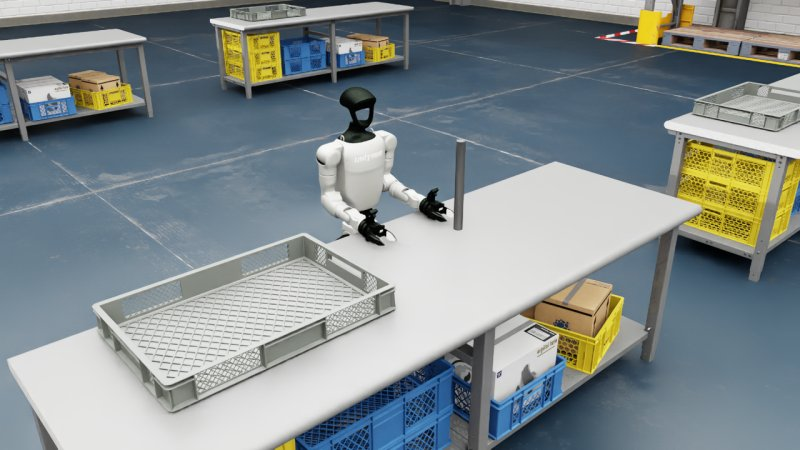</td>
    <td align="center" width="128"></td>
    <td align="center" width="128">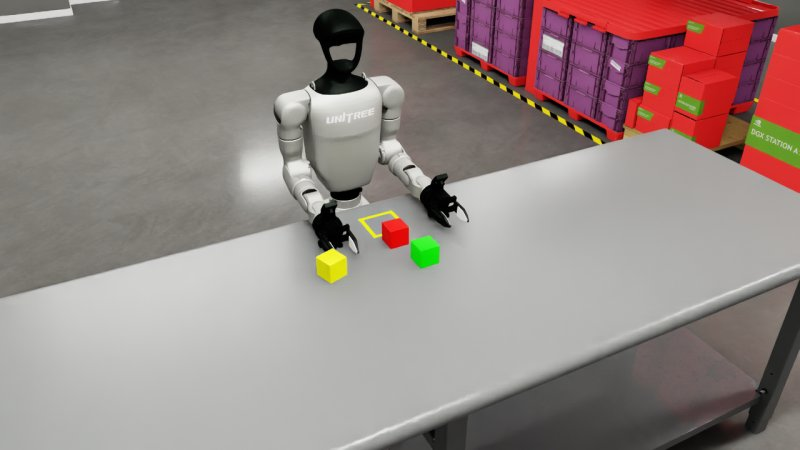</td>
    <td align="center" width="128">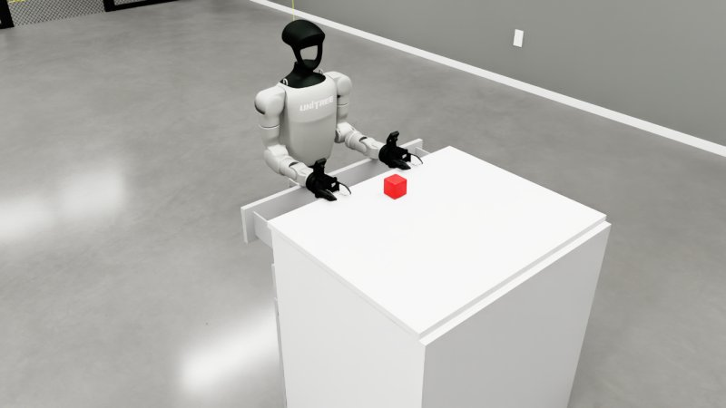</td>
    <td align="center" width="128">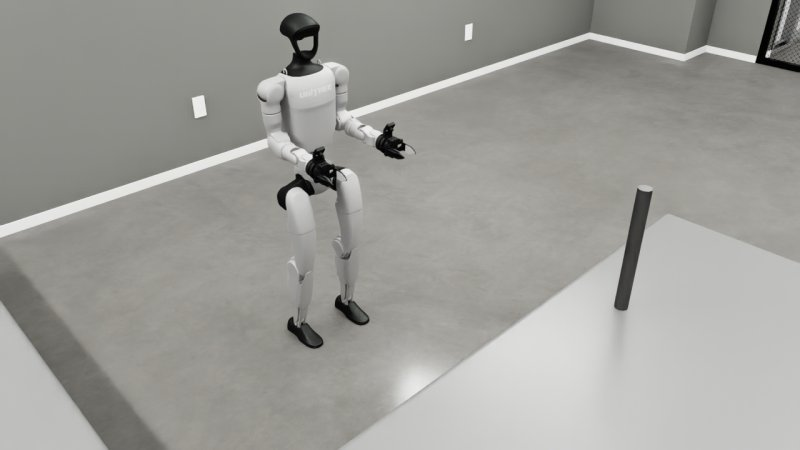</td>
  </tr>
  <tr>
    <th align="left">G1<br/>Dex3</th>
    <td align="center" width="128">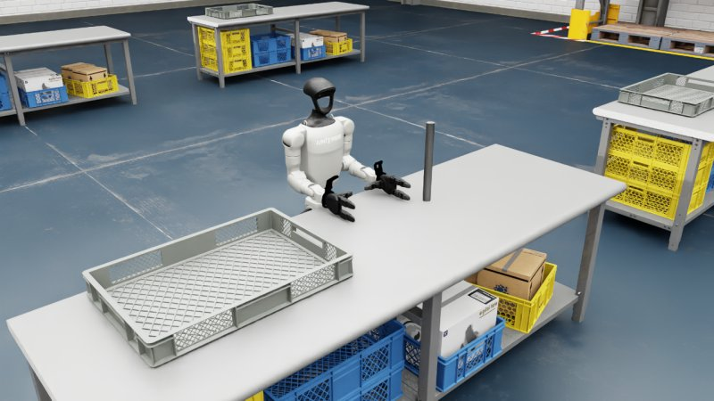</td>
    <td align="center" width="128">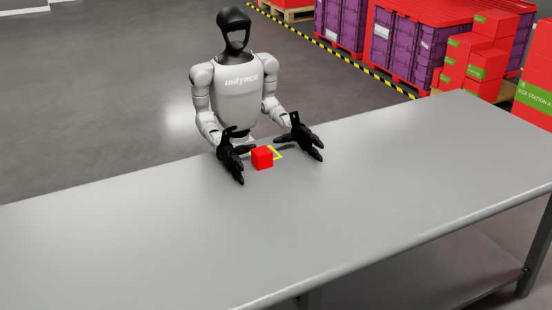</td>
    <td align="center" width="128"></td>
    <td align="center" width="128">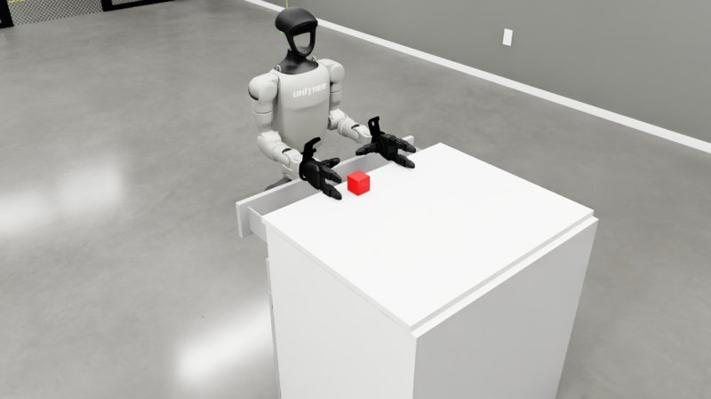</td>
    <td align="center" width="128">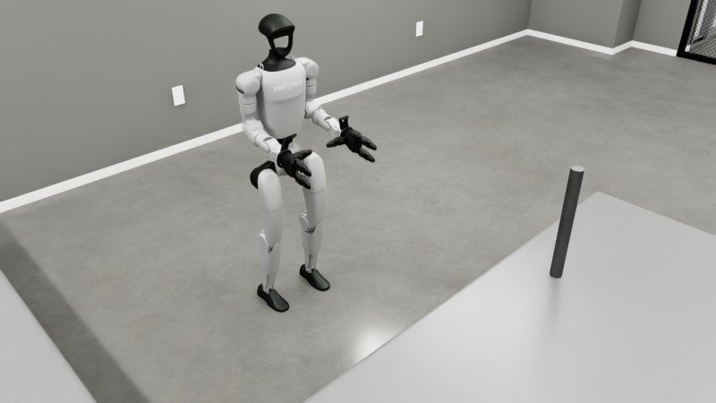</td>
  </tr>
  <tr>
    <th align="left">G1<br/>Inspire</th>
    <td align="center" width="128">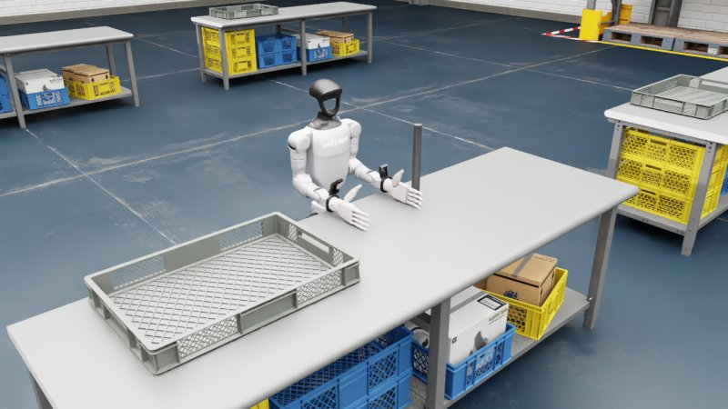</td>
    <td align="center" width="128">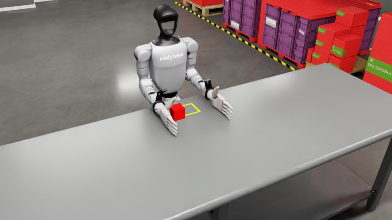</td>
    <td align="center" width="128">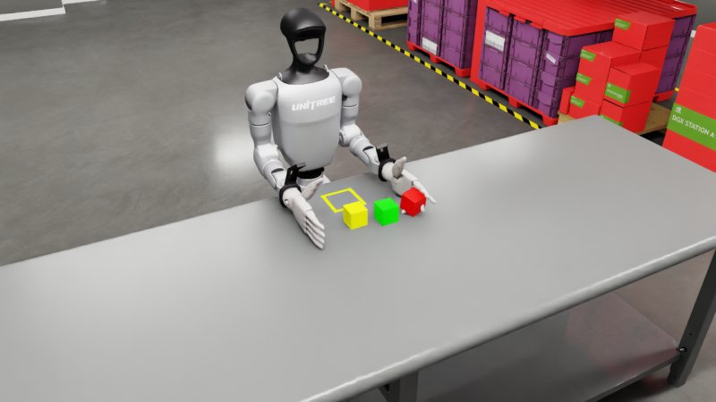</td>
    <td align="center">—</td>
    <td align="center" width="128">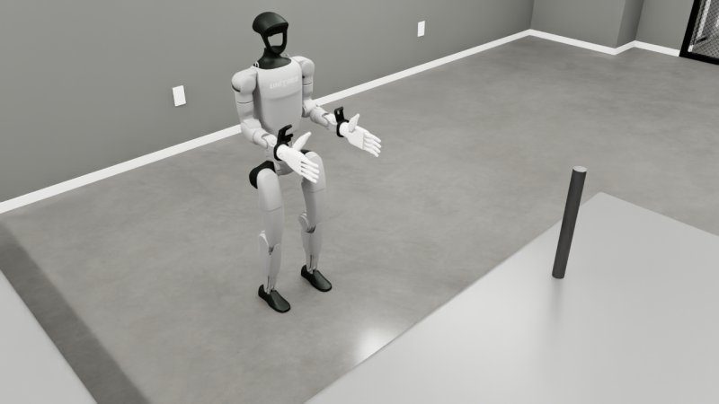</td>
  </tr>
  <tr>
    <th align="left">H1-2<br/>Inspire</th>
    <td align="center" width="128">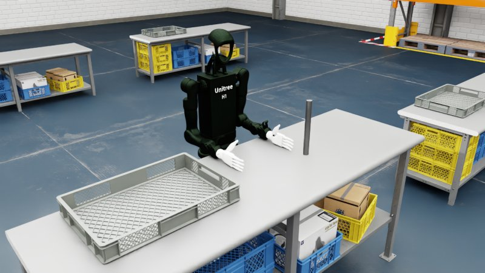</td>
    <td align="center" width="128">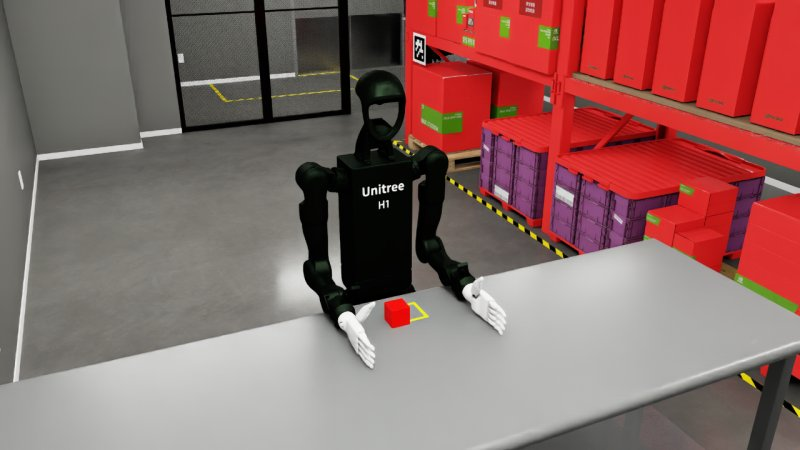</td>
    <td align="center" width="128">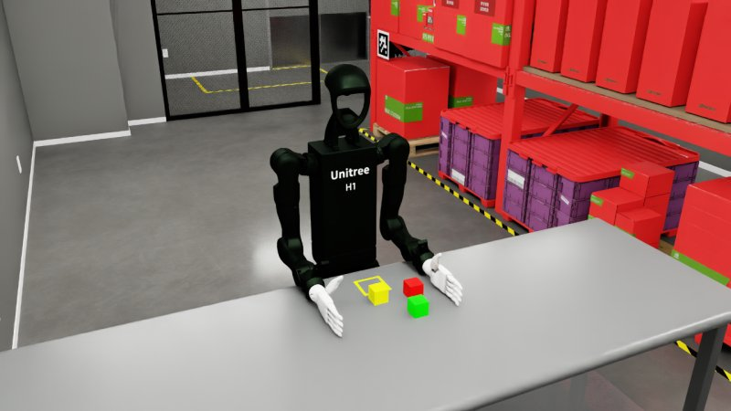</td>
    <td align="center">—</td>
    <td align="center">—</td>
  </tr>
  <tr>
    <th align="left">G1-D<br/>Dex1</th>
    <td align="center" width="128">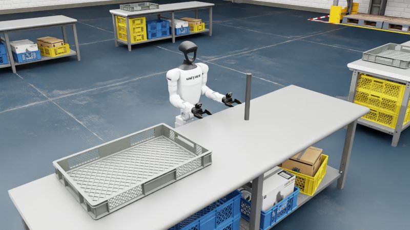</td>
    <td align="center">—</td>
    <td align="center">—</td>
    <td align="center">—</td>
    <td align="center">—</td>
  </tr>
  <tr>
    <th align="left">R1-D<br/>Dex1</th>
    <td align="center" width="128">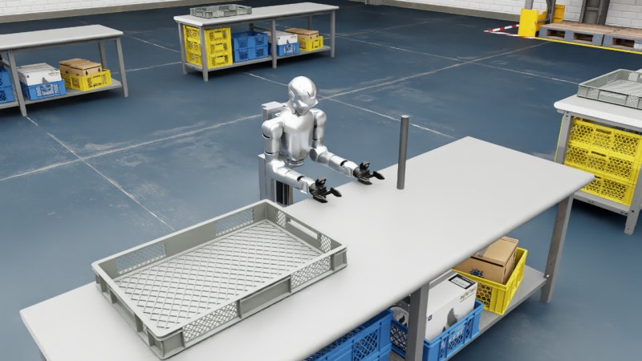</td>
    <td align="center">—</td>
    <td align="center">—</td>
    <td align="center">—</td>
    <td align="center">—</td>
  </tr>
</table>

任务名（`--task`）及对应参数：

| 任务名 | 机器人 | `--robot_type` | 手部 DDS 参数 |
|---|---|---|---|
| `Isaac-PickPlace-Cylinder-G129-Dex1-Joint` | G1 29-DoF · Dex1 | `g129` | `--enable_dex1_dds` |
| `Isaac-PickPlace-RedBlock-G129-Dex1-Joint` | G1 29-DoF · Dex1 | `g129` | `--enable_dex1_dds` |
| `Isaac-Stack-RgyBlock-G129-Dex1-Joint` | G1 29-DoF · Dex1 | `g129` | `--enable_dex1_dds` |
| `Isaac-Pick-Redblock-Into-Drawer-G129-Dex1-Joint` | G1 29-DoF · Dex1 | `g129` | `--enable_dex1_dds` |
| `Isaac-Move-Cylinder-G129-Dex1-Wholebody` | G1 29-DoF · Dex1 | `g129` | `--enable_dex1_dds` |
| `Isaac-PickPlace-Cylinder-G129-Dex3-Joint` | G1 29-DoF · Dex3 | `g129` | `--enable_dex3_dds` |
| `Isaac-PickPlace-RedBlock-G129-Dex3-Joint` | G1 29-DoF · Dex3 | `g129` | `--enable_dex3_dds` |
| `Isaac-Stack-RgyBlock-G129-Dex3-Joint` | G1 29-DoF · Dex3 | `g129` | `--enable_dex3_dds` |
| `Isaac-Pick-Redblock-Into-Drawer-G129-Dex3-Joint` | G1 29-DoF · Dex3 | `g129` | `--enable_dex3_dds` |
| `Isaac-Move-Cylinder-G129-Dex3-Wholebody` | G1 29-DoF · Dex3 | `g129` | `--enable_dex3_dds` |
| `Isaac-PickPlace-Cylinder-G129-Inspire-Joint` | G1 29-DoF · Inspire | `g129` | `--enable_inspire_dds` |
| `Isaac-PickPlace-RedBlock-G129-Inspire-Joint` | G1 29-DoF · Inspire | `g129` | `--enable_inspire_dds` |
| `Isaac-Stack-RgyBlock-G129-Inspire-Joint` | G1 29-DoF · Inspire | `g129` | `--enable_inspire_dds` |
| `Isaac-Move-Cylinder-G129-Inspire-Wholebody` | G1 29-DoF · Inspire | `g129` | `--enable_inspire_dds` |
| `Isaac-PickPlace-Cylinder-H12-27dof-Inspire-Joint` | H1-2 27-DoF · Inspire | `h1_2` | `--enable_inspire_dds` |
| `Isaac-PickPlace-RedBlock-H12-27dof-Inspire-Joint` | H1-2 27-DoF · Inspire | `h1_2` | `--enable_inspire_dds` |
| `Isaac-Stack-RgyBlock-H12-27dof-Inspire-Joint` | H1-2 27-DoF · Inspire | `h1_2` | `--enable_inspire_dds` |
| `Isaac-PickPlace-Cylinder-G1D-Dex1-Joint` | G1-D · Dex1 | `g1d` | `--enable_dex1_dds` |
| `Isaac-PickPlace-Cylinder-R1D-Dex1-Joint` | R1-D · Dex1 | `r1d` | `--enable_dex1_dds` |

## 2、⚙️ 环境配置与运行

| 组件 | 版本 |
|---|---|
| Isaac Sim | 6.2.0（`isaacsim[all,extscache]==6.2.0.0`） |
| Isaac Lab | 3.0.0（tag `v3.0.0`） |
| Python | 3.12 |
| PyTorch | 2.11.0 / torchvision 0.26.0（CUDA 13.0，`cu130`） |
| CycloneDDS | `releases/0.10.x` |
| teleimager（图像服务） | git 子模块 `teleimager/`，`sim` 分支 |

### 2.0 获取代码

图像服务 [teleimager](https://github.com/unitreerobotics/teleimager) 是 git 子模块，克隆时请带上 `--recurse-submodules`：

```bash
git clone --recurse-submodules https://github.com/unitreerobotics/unitree_sim_isaaclab.git
# 已经克隆但没有带子模块：
cd unitree_sim_isaaclab && git submodule update --init --recursive
```

拉取本仓库新版本后，子模块也要同步更新（依赖有变化时重新安装）：

```bash
git pull
git submodule update --init --recursive
pip install -e "./teleimager[server]"
```

如需使用 teleimager `sim` 分支的最新提交（而不是本仓库锁定的版本）：`git submodule update --remote teleimager`。

### 2.1 自动安装（推荐）

```bash
cd unitree_sim_isaaclab
bash auto_setup_env.sh unitree_sim_env          # 第二个参数可选：PyTorch 的 CUDA 版本标签，默认 cu130
conda activate unitree_sim_env
```

脚本会初始化 `teleimager` 子模块，在本仓库同级目录克隆 `IsaacLab`（v3.0.0）、`cyclonedds`、`unitree_sdk2_python`，创建 conda 环境并安装所有依赖（包括 `teleimager[server]`），生成图像服务证书并下载资源。

### 2.2 手动安装

请参考 <a href="doc/isaacsim6.2_install_zh.md">Isaac Sim 6.2.0 / Isaac Lab 3.0.0 环境安装步骤</a>。

### 2.3 Docker

```bash
cd unitree_sim_isaaclab
git submodule update --init --recursive                # 镜像从当前目录构建，包括 teleimager 子模块
bash fetch_assets.sh                                   # 资源运行时挂载，不打包进镜像
sudo docker build -t unitree-sim:latest -f Dockerfile .
# 需要代理时: --build-arg http_proxy=http://127.0.0.1:7890 --build-arg https_proxy=http://127.0.0.1:7890
```

镜像基于 `nvidia/cuda:13.0.0-runtime-ubuntu22.04`，包含 Isaac Sim 6.2.0、Isaac Lab 3.0.0、CycloneDDS、unitree_sdk2_python 以及本仓库源码。宿主机需要 NVIDIA 驱动 ≥ 580.65.06 并安装 NVIDIA Container Toolkit。

```bash
xhost +local:docker
sudo docker run --gpus all -it --rm --network host \
  -e NVIDIA_VISIBLE_DEVICES=all -e NVIDIA_DRIVER_CAPABILITIES=all \
  -e DISPLAY=$DISPLAY -v /tmp/.X11-unix:/tmp/.X11-unix:rw \
  -v /etc/vulkan/icd.d:/etc/vulkan/icd.d:ro -v /usr/share/vulkan/icd.d:/usr/share/vulkan/icd.d:ro \
  -v $(pwd)/assets:/home/code/unitree_sim_isaaclab/assets \
  unitree-sim:latest
# 容器内运行（无显示器的服务器请加 --no_render）:
python sim_main.py --device cpu --task Isaac-PickPlace-Cylinder-G129-Dex1-Joint --enable_dex1_dds --robot_type g129
```

`--network host` 使 DDS 话题和图像服务端口直接使用宿主机网络。

### 2.4 资源下载

资源按文件从 HuggingFace 数据集 [unitreerobotics/unitree_sim_isaaclab_usds](https://huggingface.co/datasets/unitreerobotics/unitree_sim_isaaclab_usds) 的 `assets/` 目录下载到 `./assets`（`auto_setup_env.sh` 已包含此步骤；包含场景、G1 / H1-2 的 USD 以及 G1-D / R1-D 的 URDF）：

```bash
bash fetch_assets.sh                                   # 全部资源
bash fetch_assets.sh robots/g1-29dof-dex1-base-fix-usd urdf   # 只下载指定目录（assets/ 下的路径）
```

重复运行只会下载缺失或有更新的文件，本地多出的文件（如 `assets/robots/.urdf_cache`、自己导入的场景）会保留。可用 `HF_ENDPOINT=https://hf-mirror.com` 走镜像。

上传（需要对 `unitreerobotics` 组织有写权限的 token；只传新增/修改的文件，本地缓存不上传）：`HF_TOKEN=hf_xxx bash upload_assets.sh [scenes/kitchen ...]`。

机器人既可以用 USD 也可以用 URDF 描述（`robots/robot_assets.py`）：URDF 会在第一次使用时转换为 USD 并缓存在 `assets/robots/.urdf_cache/`。G1-D 和 R1-D 分别从
`assets/urdf/g1_d_description/g1_d_with_dex1_1.urdf`、`assets/urdf/r1_d_description/r1_d_with_dex1_1.urdf` 加载。

### 2.5 遥操作

```bash
# G1 29 自由度 + Dex1 夹爪
python sim_main.py --device cpu --task Isaac-PickPlace-Cylinder-G129-Dex1-Joint --enable_dex1_dds --robot_type g129
# G1 29 自由度 + Dex3
python sim_main.py --device cpu --task Isaac-PickPlace-Cylinder-G129-Dex3-Joint --enable_dex3_dds --robot_type g129
# H1-2 + Inspire
python sim_main.py --device cpu --task Isaac-PickPlace-Cylinder-H12-27dof-Inspire-Joint --enable_inspire_dds --robot_type h1_2
# G1 Wholebody（行走）
python sim_main.py --device cpu --task Isaac-Move-Cylinder-G129-Dex1-Wholebody --enable_dex1_dds --robot_type g129
# G1-D
python sim_main.py --device cpu --task Isaac-PickPlace-Cylinder-G1D-Dex1-Joint --enable_dex1_dds --robot_type g1d
# R1-D
python sim_main.py --device cpu --task Isaac-PickPlace-Cylinder-R1D-Dex1-Joint --enable_dex1_dds --robot_type r1d
```

主要参数：
- `--task`：任务名称，见上表。
- `--robot_type`：`g129` | `h1_2` | `g1d` | `r1d`，决定机身 DDS 与动作映射，需与任务中的机器人一致。
- `--enable_dex1_dds` / `--enable_dex3_dds` / `--enable_inspire_dds`：分别开启二指夹爪 / 三指灵巧手 / Inspire 手的 DDS（只能选一个）。
- `--enable_wholebody_dds`：开启移动控制指令（`Wholebody` 任务会自动开启）。
- `--camera_calib <文件>`：相机标定文件（见 2.6）。默认：`$UNITREE_CAMERA_CALIB` 或 `robots/uniclib_calibration.json`。
- `--camera_include` / `--camera_exclude`：逗号分隔的相机名，开启 / 关闭对应相机（默认：头部双目 + 左右腕部相机）。
- `--no_render`：不启动 Sim 窗口并开启 WebRTC 视频流（Docker / 无显示器服务器上使用），可以用 [Isaac Sim WebRTC Streaming Client](https://docs.isaacsim.omniverse.nvidia.com/latest/installation/manual_livestream_clients.html) 查看画面。
- `--device cpu`：物理仿真运行在 CPU 上（遥操作任务推荐）。
- `--render_fps`（默认 30）：相机和视窗的渲染频率（按仿真时间计），控制循环仍按 `--step_hz` 运行。调高画面更流畅，但仿真会变慢。
- `--render_sync`：每次渲染都等待 GPU 完成（图像严格同步，但更慢）。默认不等待，图像最多晚一帧。
- `--image_server_in_process`：图像服务和仿真跑在同一进程（旧行为；默认在独立进程中运行）。
- `--view_camera`（`auto` | `world` | `follow` | `none`）：启动时视窗使用的相机。`world` 为固定的整体视角 `/World/PerspectiveCamera`；`follow` 为机器人后上方的跟随相机 `/World/FollowCamera`（跟随位置和朝向）；`auto` 时可移动机器人（G1-D、R1-D、`Wholebody` 任务）用 `follow`，其余用 `world`。两个视角都可以随时在视窗的相机菜单里切换；它们是普通 USD 相机，不被查看时不产生渲染开销。

各机器人使用的 DDS 话题（domain 1）：

| 机器人 | 机身 | 末端执行器 | 底盘 / 升降 |
|---|---|---|---|
| G1 / H1-2 | `rt/lowcmd`、`rt/lowstate`（unitree_hg） | `rt/dex1/{left,right}/*`、`rt/dex3/{left,right}/*`、`rt/inspire/*` | `Wholebody`：`rt/run_command/cmd`（见 `send_commands_keyboard.py`、`send_commands_8bit.py`） |
| G1-D | `rt/lowcmd`、`rt/lowstate`（腰 yaw 12，手臂 15–28；腰 pitch：`rt/waistpitchcmd` → `rt/waistpitchstate`，lowstate 13/14 同时上报，lowcmd 13 启用时也生效） | lowcmd/lowstate 31（左）/ 33（右），或 `rt/dex1/{left,right}/*` | `rt/cmd_vel_no_limit`、`rt/cmd_hispeed` → `rt/hispeed_state`、`rt/slamware_ros_sdk_server_node/odom` |
| R1-D | `rt/lowcmd`、`rt/lowstate`（升降柱 12，腰 13，手臂 15–28，头 29/30） | lowcmd/lowstate 31（左）/ 33（右），或 `rt/dex1/{left,right}/*` | `rt/cmd_vel`（归一化）→ `rt/state_vel`、`rt/height_state`、`rt/height_alarm` |

G1-D / R1-D 与真机（unirobot）布局一致：Dex1 夹爪是 lowcmd 的 31 / 33 号电机（internal 接线，电机 q 0 闭合 … 5.4 张开；该槽位 mode 为 1 且 kp > 0 时生效，此时优先于 `rt/dex1/*`）；G1-D 腰 pitch 通过 `rt/waistpitchcmd`（unitree_hg `MotorCmd_`）控制。收到 `rt/waistpitchcmd` 之前，lowcmd 13 号只有在 mode 为 1 时才驱动腰 pitch。lowstate 中同时上报两个夹爪电机，以及 13、14 号上的腰 pitch。

R1-D 的速度档位可通过环境变量 `UNITREE_R1D_GEAR=low|mid|high` 设置（默认 `low`）。

### 2.6 相机与图像服务

仿真的相机图像通过图像服务 [teleimager](https://github.com/unitreerobotics/teleimager)（git 子模块 `teleimager/`，`sim` 分支；仿真配置 `teleimager_server_isaacsim.yaml` 随包提供，可用 `$TELEIMAGER_CONFIG` 覆盖）发布，接口与真机图像服务一致，[xr_teleoperate](https://github.com/unitreerobotics/xr_teleoperate) 可直接连接（把 xr_teleoperate 中图像服务的 IP 改成运行仿真的机器 IP）。

| 相机 | ZMQ | WebRTC（https） |
|---|---|---|
| 头部（双目，左右拼接 1280×480） | 55555 | 60001 |
| 左腕 | 55556 | 60002 |
| 右腕 | 55557 | 60003 |

- 头部为双目相机。内参、畸变、双目外参以及腕部手眼位姿从标定文件读取（`--camera_calib`，格式同 `robots/uniclib_calibration.json`）。标定文件中缺少的、或与仿真机器人不匹配的参数，会使用机器人 URDF / USD 中的相机安装位置。
- 如果图像服务的端口已被占用，启动时会直接报错退出。这些端口位于临时端口范围，可能被其他程序占用，可以预留：
  `sudo sysctl -w net.ipv4.ip_local_reserved_ports=55555-55557,60001-60003`（写入 `/etc/sysctl.conf` 可永久生效）。
- WebRTC 页面使用 `~/.config/teleimager/` 中的自签名证书（`auto_setup_env.sh` 会生成；不存在时使用 `~/.config/xr_teleoperate/` 中的证书），首次访问需要在浏览器中信任该证书。

### 2.7 键盘测试脚本

没有 XR 设备时，可以先启动仿真（2.5），再在同一环境的另一个终端运行：

```bash
python tools/g1_keyboard_teleop.py --hand dex1     # G1：手臂 + 手（dex1 / dex3 / inspire）
python tools/g1d_keyboard_teleop.py                # G1-D：底盘、升降柱、腰、手臂、夹爪
python tools/r1d_keyboard_teleop.py                # R1-D：底盘、升降柱、腰、头、手臂、夹爪
```

脚本发布与 xr_teleoperate 相同的 DDS 话题。手在笛卡尔空间中移动（逆运动学见 `tools/arm_ik.py`）：

| 按键 | 功能 |
|---|---|
| I / K、J / L、U / O | 手 前 / 后、左 / 右、上 / 下 |
| [ / ]、; / '、, / . | 横滚、俯仰、偏航 |
| TAB | 切换手：左 / 右 / 双手（镜像） |
| P | 回到初始姿态 |
| Z / X、C / V | 左 / 右夹爪 闭合 / 张开 |
| W / S、A / D | 底盘 前进 / 后退、转向（G1-D、R1-D） |
| R / F、空格 | 升降 上 / 下、底盘与升降停止（G1-D、R1-D） |
| T / G、Y / H | G1-D：腰 俯仰 / 偏航；R1-D：头 俯仰 / 偏航 |
| Q / E | R1-D：腰 偏航 |
| ESC | 退出 |

### 2.8 数据回放

```bash
python sim_main.py --device cpu --task Isaac-Stack-RgyBlock-G129-Dex1-Joint --enable_dex1_dds --robot_type g129 \
    --replay_data --file_path "/path/to/xr_teleoperate/teleop/utils/data"
```
- `--replay_data`：回放已录制的数据。
- `--file_path`：数据集目录（格式与 [xr_teleoperate](https://github.com/unitreerobotics/xr_teleoperate) 遥操作录制的数据一致）。

任务的离散奖励可以通过 `get_step_reward_value` 获取。

### 2.9 数据生成

在数据回放过程中修改光照和相机参数并重新采集图像，可以生成更多样的视觉数据用于数据增强，提高模型的泛化能力。

```bash
python sim_main.py --device cpu --task Isaac-Stack-RgyBlock-G129-Dex1-Joint --enable_dex1_dds --robot_type g129 \
    --replay_data --file_path "/path/to/xr_teleoperate/teleop/utils/data" --generate_data --generate_data_dir "./data2"
```
- `--generate_data`：生成新数据；`--generate_data_dir`：新数据保存目录。
- `--rerun_log`：生成数据时开启 rerun 日志。
- `--modify_light` / `--modify_camera`：修改光照 / 相机参数（需相应修改 `sim_main.py` 中的 `update_light` / `batch_augment_cameras_by_name`）。

大规模生成数据之前，请先仔细调试并测试这些参数。

## 3、任务场景搭建

### 3.1 代码结构

```
unitree_sim_isaaclab/
├── action_provider          [动作来源：DDS（G1/H1-2、Wholebody、G1-D、R1-D）、文件回放、策略]
├── dds                      [DDS 通信：机身、Dex1 / Dex3 / Inspire、G1-D / R1-D 底盘与升降、奖励、重置]
├── layeredcontrol           [底层控制：把动作设置到仿真环境中]
├── robots
│   ├── robot_assets.py      [从 USD 或 URDF 加载机器人（URDF 转 USD、连杆颜色、连杆 prim 路径）]
│   ├── unitree.py           [G1 / H1-2 配置]
│   ├── unitree_g1d.py       [G1-D 配置]
│   ├── unitree_r1d.py       [R1-D 配置]
│   └── uniclib_calibration.json  [默认相机标定文件]
├── tasks
│   ├── common_config        [机器人 / 相机预设、相机标定读取、环境基础配置]
│   ├── common_event         [事件管理]
│   ├── common_observations  [机器人 / 手 / 夹爪 / 相机状态 -> DDS 与共享内存]
│   ├── common_rewards
│   ├── common_scene         [公共场景（除机器人以外的部分）]
│   ├── common_termination   [物体超出范围 / 重置条件]
│   ├── g1_tasks             [G1 任务]
│   ├── h1-2_tasks           [H1-2 任务]
│   ├── g1d_tasks            [G1-D 任务]
│   ├── r1d_tasks            [R1-D 任务]
│   └── utils
├── teleimager               [图像服务（ZMQ + WebRTC），git 子模块，sim 分支]
├── tools                    [键盘测试脚本、手臂逆解、数据转换、USD 工具]
├── auto_setup_env.sh        [环境安装脚本]
├── fetch_assets.sh          [资源下载脚本]
└── sim_main.py              [主程序]
```

### 3.2 任务场景搭建步骤

使用已有的机器人配置搭建新任务时，按以下步骤操作：

#### 3.2.1 公共场景
参考已有文件，在 `tasks/common_scene` 中添加新任务的公共场景（除机器人以外的部分）。

#### 3.2.2 终止或物体重置条件
在 `tasks/common_termination` 中添加所需的判断条件。

#### 3.2.3 添加并注册任务
参考已有任务（如 `pick_place_cylinder_g1_29dof_dex1`），在 `tasks/<robot>_tasks/` 下新建任务目录：

- `mdp/observations.py`：导入需要的观测函数

```python
from tasks.common_observations.g1_29dof_state import get_robot_boy_joint_states
from tasks.common_observations.gripper_state import get_robot_gipper_joint_states
from tasks.common_observations.camera_state import get_camera_image

__all__ = ["get_robot_boy_joint_states", "get_robot_gipper_joint_states", "get_camera_image"]
```

- `mdp/terminations.py`：从 `common_termination` 导入判断条件

```python
from tasks.common_termination.base_termination_pick_place_cylinder import reset_object_estimate

__all__ = ["reset_object_estimate"]
```

- `__init__.py`：注册任务名

```python
import gymnasium as gym

from . import pickplace_cylinder_g1_29dof_dex1_joint_env_cfg

gym.register(
    id="Isaac-PickPlace-Cylinder-G129-Dex1-Joint",
    entry_point="isaaclab.envs:ManagerBasedRLEnv",
    kwargs={"env_cfg_entry_point": pickplace_cylinder_g1_29dof_dex1_joint_env_cfg.PickPlaceG129DEX1BaseFixEnvCfg},
    disable_env_checker=True,
)
```

- 环境配置文件（如 `pickplace_cylinder_g1_29dof_dex1_joint_env_cfg.py`）：导入公共场景、设置机器人位置并添加相机。配置类继承自 `tasks.common_config.env_configs.UnitreeManagerBasedRLEnvCfg`。注意 Isaac Lab 3.0 中四元数的顺序是 **(x, y, z, w)**。
- 在 `tasks/<robot>_tasks/__init__.py` 中导入新的任务模块。

### 3.3 用自己的 USD 场景一键生成任务

任意 USD 场景（房间、厨房等）都可以一步和机器人组装成仿真任务：

```bash
python tools/create_usd_task.py --usd /path/to/scene.usda --name Kitchen --robot-pose 1.0,-2.0,0 --check
python sim_main.py --device cpu --task Isaac-Kitchen-R1D-Dex1-Joint --enable_dex1_dds --robot_type r1d
```

- USD 及其引用的所有文件会拷贝到 `assets/scenes/<name>/`，场景按原样仿真（自带的刚体、门、灯光）。单位和朝上轴会自动转换，场景没有地面 / 灯光时才会补上。
- 按现有目录结构为每个机器人生成一个任务（`tasks/<robot>_tasks/<name>_<robot>/`），机器人、相机、DDS、键盘 / XR 控制与内置任务相同：`Isaac-<name>-G129-Dex1-Joint`、`...-G129-Dex3-...`、`...-G129-Inspire-...`、`...-G1D-Dex1-...`、`...-R1D-Dex1-...`（用 `--robots` 选择）。
- **机器人站立位置**：修改 `tasks/common_scene/usd_scene_<name>.py` 中的 `SPEC["robots"]`（`pos` 为场景坐标 [x, y, z]，`yaw_deg` 朝向，`joint_pos` 如升降柱高度），改完重启 `sim_main.py` 即可。工具运行结束时会打印具体文件和行号。也可以用 `--robot-pose x,y,yaw_deg`，或在 USD 里放一个名为 `RobotBase` 的 prim（位置 + 朝向）；都不给时自动选场景中部附近的一块空地。
- `--check` 会无头运行每个任务（机器人稳定、无 NaN、机器人没有推动场景里的门 / 抽屉）并渲染预览图 `img/tasks/<task>.jpg`。
- 重新运行工具时，已手动修改过的文件会保留；加 `--force` 覆盖。

### 📋 TODO List

- ⬜ 持续增加新的任务场景
- ⬜ 持续进行代码优化

## 🙏 鸣谢

该代码基于以下开源代码库构建。请访问以下链接查看各自的许可证：

1. https://github.com/isaac-sim/IsaacLab
2. https://github.com/isaac-sim/IsaacSim
3. https://github.com/zeromq/pyzmq
4. https://github.com/unitreerobotics/unitree_sdk2_python
